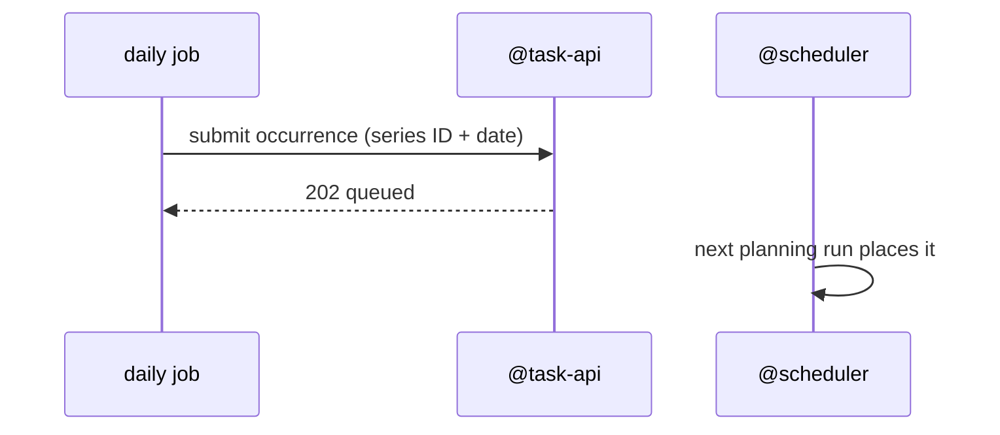

# Recurring tasks

A design doc in the team's usual TDD layout. Only the front matter and the checklist are Anaxi; the
headings map to levels on their own (FORMAT.md §4).

## Context and goals

Users re-enter the same chores every week ("water plants", "pay rent"). Success: fewer than 5 % of recurring
chores are re-entered by hand after launch.

## Non-goals

Habit tracking, streaks, or reminders separate from the calendar.

## Requirements

In the task sheet, a user picks "repeat weekly on …" or "repeat monthly on day n". Each occurrence is an ordinary
task, created one week ahead of its date and scheduled like any other. Editing the series changes future
occurrences only; deleting asks "this one or all future".

- Acceptance: a weekly series created on Monday has its next four occurrences placed in the calendar within a
  day; deleting "all future" removes them and nothing else.
- Edge cases: a monthly task on the 31st falls on the last day of shorter months; a missed occurrence doesn't
  block the next one; a series created offline syncs like any task.
- While saving, the sheet shows "repeats every Monday", not a list of dates.

## Dependencies

- [@task-api](../shared/task-api.md): occurrences are submitted like any other task
- [@scheduler](../shared/scheduler.md): places each occurrence
- [@stack](../shared/stack.md): nothing new

## Proposed design

The series is stored with the user's tasks. A daily job materializes occurrences seven days ahead and submits
each one through @task-api with a deterministic `submissionId` (series ID + date), so a job retry can't create
a duplicate.

The series record is in the [appendix](APPENDIX.md#recurring-tasks-series-record-d3).

Decision: materialize ahead of time. Rejected: having the planner expand series on the fly (it would couple
@scheduler to recurrence rules).

### Rule grammar

The rule engine accepts a pluggable `RecurrenceRule` interface, with built-in weekly and monthly rules and a
parser for RFC 5545 RRULE strings, so power users can enter any pattern…

## Open questions

- [x] D1 · Editing a series: this one, or all future ones? → all future ones (see Requirements)
- [ ] D2 · Do paused series still count toward the daily nudge cap?
- [ ] D3 · Which time zone does a recurrence follow when the user travels?

## Appendix: sketches

Idea, not decided: after a user enters the same task by hand three weeks running, offer to make it recurring.
